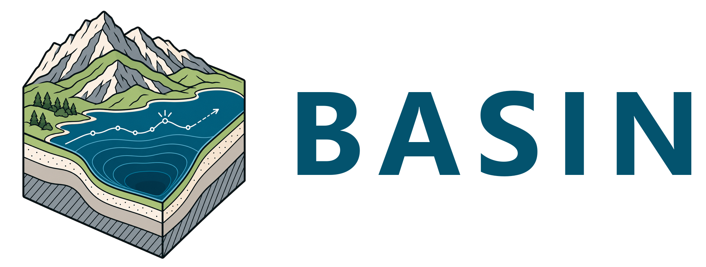

<p align="center">
  <picture>
    <source media="(prefers-color-scheme: dark)" srcset="assets/basin_wordmark_dark.png">
    <source media="(prefers-color-scheme: light)" srcset="assets/basin_wordmark_light.png">
    
  </picture>
</p>

# Basin

Basin is a time-series foundation model (TSFM) for the operational domain:
sensor readings, process measurements, equipment telemetry, energy and
utility loads, and similar data from running systems. It is built on
**RWKV-7**, a linear-attention architecture, and is tuned for one thing in
particular: **accurate short- to medium-term forecasts**.

You give Basin the recent history of one or more series, optionally with
related covariates, and it returns probabilistic forecasts (a median plus
nine quantiles) without any per-dataset training.

The technical documentation (architecture, training pipeline, synthetic data
generator, benchmarks and audits) lives in [`docs/`](docs/). Start with the
[technical overview](docs/TECHNICAL_OVERVIEW.md).

## Quickstart

Basin comes in three versions. They hold the same trained weights and
produce the same forecasts (within about 0.4% of a series' standard
deviation); they differ in what you need to install and how fast they run.

| Version | Requirements | Set-up effort | Platform | Median latency per forecast* |
|---|---|---|---|---|
| **Full custom** (this repository) | CUDA toolkit, C compiler, custom RWKV-7 kernels | High | NVIDIA GPU, Linux / WSL2 | **7.9 ms** (CUDA graph replay) |
| **FLA** (`basin-rwkv7-fla`) | `torch`, `safetensors`, `flash-linear-attention` (Triton) | Moderate | NVIDIA GPU, Linux / WSL2 | 43.6 ms |
| **Pure PyTorch** (`basin-rwkv7-pytorch`) | `torch`, `safetensors` | Minimal | CPU or GPU, any OS including Windows | 61.9 ms on GPU, 213 ms on CPU |

<sub>*Measured on an RTX 5070. See the
[portable models report](docs/audits/2026-11-13/portable_models/REPORT.md).</sub>

If you just want to try Basin, use the **pure PyTorch** version. Switch to
FLA or the full custom build when forecast latency matters.

### 1. Get the model

> **Coming soon:** the portable model folders will be published on Hugging
> Face. Each folder is self-contained: the weights (`model.safetensors`),
> `config.json` and a single Python file with the model code.

### 2. Install the dependencies

```bash
pip install torch safetensors                 # pure PyTorch version
pip install torch safetensors flash-linear-attention   # FLA version (Linux + NVIDIA GPU)
```

### 3. Forecast

```python
import sys
import torch

sys.path.insert(0, "path/to/basin-rwkv7-pytorch")
from modeling_basin_pytorch import BasinPyTorch

model = BasinPyTorch.from_pretrained("path/to/basin-rwkv7-pytorch", device="cpu")

# [target series, time]; NaN marks missing values
context = torch.randn(1, 512).cumsum(-1)
# optional [covariate, time], on the same time axis
covariates = torch.randn(3, 512)

forecast = model.forecast(context, horizon=64, past_covariates=covariates)
forecast.point  # [target, horizon]: median forecast
forecast.quantiles  # [target, horizon, 9]: quantiles 0.1 to 0.9
```

For the FLA version, import `BasinFLA` from `modeling_basin_fla` and load it
on `device="cuda"`; the interface is the same. Both portable versions run in
the precision the model was trained and evaluated in (bfloat16, with float32
inside the recurrence). Pass `dtype=torch.float32` for full precision.

The full custom version is what the training and evaluation pipeline in this
repository uses. Its set-up (WSL2, CUDA, patched RWKV-7 kernels) is described
in the [RWKV-7 setup guide](docs/RWKV-7_setup/README_RWKV7_FAST_SETUP.md) and
the [technical overview](docs/TECHNICAL_OVERVIEW.md).

> **Note on model versions.** The portable versions currently contain the
> previous 500M-parameter Basin model, which forecasts 64 steps per pass
> (longer horizons are rolled out). The current model is a 220M-parameter
> RWKV-7/attention hybrid that forecasts 112 steps per pass; its portable
> exports will follow once it is fully trained.

---

## What do you consider operational data?

Sensor data and other measurements from cyber-physical systems: machines,
plants and infrastructure where physical processes are monitored and
controlled by software. Think of temperatures, pressures, flows and vibration
in a factory, the compressor of a train, the pumps in a water network, or
the load on a power grid.

## Why a TSFM only for the operational domain?

Most TSFMs try to do it all: one model for finance, weather, retail,
traffic, healthcare and industrial data at once. Basin deliberately does
not.

First, it is not clear that mixing domains helps. Recent research from
Microsoft, [*Does Cross-Domain Pre-Training Truly Help Time Series
Foundation Models?*](https://www.microsoft.com/en-us/research/publication/does-cross-domain-pre-training-truly-help-time-series-foundation-models/),
finds that cross-domain pre-training can cause **negative transfer**: data
from other domains can make a model *worse* on the domain you care about.

Second, it matches how TSFMs are used. Most practitioners work within one
domain and never run their forecasting model across unrelated kinds of data.
A model that is very good at that one domain is worth more to them than one
that is decent at everything.

Third, capacity is limited. A model can only absorb so many patterns for a
given parameter count. When it has to learn every domain, rare patterns
from different domains [compete for the same parameter
space](https://arxiv.org/pdf/2605.29548), and the rare, complex behaviour of
any single domain gets crowded out. Focusing on one domain leaves room for
exactly those rare and difficult cases: process upsets, equipment cycling,
control-loop behaviour and sensor faults.

A useful analogy: mainstream models such as Chronos-2 and Timestral behave
like general-purpose large language models, while Basin is closer to a
*small* language model specialised for one field.

You could close the gap by simply making a general model bigger, but that
has two costs:

1. **Forecast latency.** Larger models take longer to produce a forecast.
   Latency is already the weak spot of TSFMs compared with traditional
   machine-learning methods, and Basin does not want to make it worse than
   necessary.
2. **Model size.** Larger models take more disk space and memory, and may
   no longer fit in the RAM or VRAM of the machine that has to run them.

## Why a focus on short- to medium-term forecasting?

Many mainstream TSFMs forecast very long horizons, often more than 1,000
timesteps. That choice is not free.

Early in training, short-term and long-term accuracy improve together. Later
on they start to compete: the loss function either rewards accurate
short-term forecasts or accurate long-term ones, and gains at long horizons
can come at the cost of the short term. With an equally weighted loss over a
1,000+ step horizon, about **90% of the loss comes from steps 100 to 1,000**,
so training is dominated by the far future.

For most applications the near future is what matters. With daily data,
practitioners usually want to know what happens tomorrow, next week or next
month, not a year from now. Basin therefore forecasts **112 timesteps per
pass**, which covers most practical needs, and spends its capacity on making
those steps accurate. (Longer horizons are still possible by rolling the
forecast forward.)

Some uses don't need long horizons at all. In anomaly detection, for
example, the actual values are already known: you re-forecast the series
and look for places where the actuals deviate strongly from the forecast. A
horizon of 1,000+ steps adds nothing there.

## Why the RWKV-7 architecture?

Almost every mainstream TSFM is a transformer. Basin is built on RWKV-7, a
linear-attention (recurrent) architecture, for three reasons.

**It is strong at short-range prediction.** In private language-modelling
experiments, RWKV-7 was very competitive with a modern transformer on
short-range prediction accuracy, and fell behind only on longer-range
prediction (see the
[linear attention models experiment report](docs/linear_attention_models_experiment_report.pdf)).
[Other research](https://arxiv.org/abs/2610.12883) reached a similar
conclusion. That profile fits a model that focuses on short- to
medium-term forecasts.

**It is fast at inference.** Linear attention processes a sequence in linear
time with a fixed-size state, rather than attending over the whole history
at every step. That helps with forecast latency, which is where TSFMs are
weakest.

**It is an open question worth testing.** Part of the motivation is
personal interest: Basin is also a benchmark of how a linear-attention
architecture compares with the transformers that dominate today's TSFMs.
The current model is a hybrid that keeps RWKV-7 as its backbone and adds a
small amount of attention across time and across variables. See the
[220M hybrid architecture notes](docs/model_training/HYBRID_220M_2026-11-15.md).

## Why only train on synthetic data?

**Licensing.** Training only on data we generate ourselves guarantees that
Basin never accidentally learns from a dataset whose license doesn't allow
it.

**Variety.** Real operational data does exist online, for example the
[MetroPT-3 dataset](https://archive.ics.uci.edu/dataset/791/metropt+3+dataset)
from the Porto metro. But such a dataset is a large amount of data from a
*single* cyber-physical system. To generalise broadly, a model needs data
from many *different* kinds of systems, and there are not many open-source
datasets of cyber-physical systems. Synthetic data solves this: Basin's
generator builds new structural causal models on the spot, each one a
different system with its own sensors, causal links, control loops,
episodes and faults.

**Availability.** The large bundled collections that do exist, such as
[GIFT-Eval Pretrain](https://huggingface.co/datasets/Salesforce/GiftEvalPretrain),
mix data from many domains. Filtering them down to only the operational
domain would be cumbersome.

## Why is the project named Basin?

It is a loose analogy to a *data lake*. A TSFM's real competitive advantage
is its training data: the key is to train on a wide variety of the typical
cases *and* the rare, unusual ones that the model may come across in real
life within its domain. A basin is narrow compared with a lake but deep, and
that depth stands for the depth of the training data within one domain.

---

## Learn more

- [Technical overview](docs/TECHNICAL_OVERVIEW.md): repository layout,
  runtime environment, synthetic data generation, training and evaluation
- [Forecasting guide](docs/forecasting/FORECASTING.md): architecture and
  forecasting examples
- [Portable models report](docs/audits/2026-11-13/portable_models/REPORT.md):
  how the FLA and pure PyTorch versions were built and verified
- [Open issues](docs/OPEN_ISSUES.md)

The vendored RWKV source keeps its upstream Apache-2.0
[license](third_party/rwkv-lm/LICENSE).
