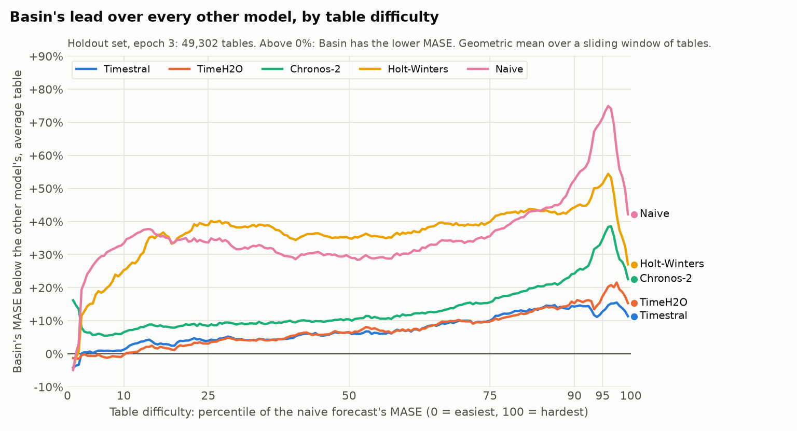
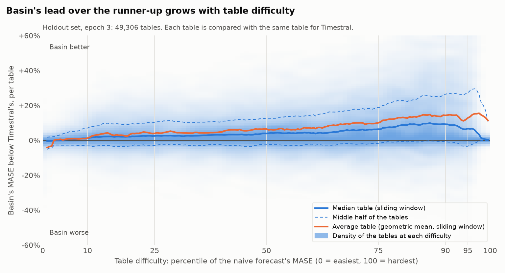

# Benchmark results

Results of Basin against published time-series foundation models. Each
section names the run it comes from, so the numbers can be traced to the
result files.

## Holdout set (epoch 3)

| | |
|---|---|
| Basin weights | best weights after epoch 3 (step 4,526,436), 221.5 million parameters |
| Tables | 49,475 scored tables (the full holdout set), 27.1 million scored points |
| Forecast | 112 points from up to 5 origins per table, up to 2,048 points of history |
| Metric | MASE per table: mean absolute error divided by the mean absolute one-step change in the history. Lower is better. |
| Run | `results/model/holdout_test/20261126T081803Z_epoch3_step4526436`, also in Azure under the same path |

### How to read these results

The holdout tables are fully independent test cases: none of them was part of
Basin's training or validation data. They do come from the same generator as
Basin's training data. Basin has therefore seen the same kinds of series
during training, and the other models have not. This gives Basin a natural
advantage on this benchmark that it would not have on data from another
source.

Even with that in mind the gap is large, and it is largest on the difficult
tables.

### Results

Each table gives one MASE per model. The columns are percentiles of those
per-table scores: p5 is a table the model finds easy, p95 one it finds very
hard.

| Model | p5 | p10 | p25 | Median | p75 | p90 | p95 | Median latency per forecast |
|---|---|---|---|---|---|---|---|---|
| **Basin** | 0.851 | **1.087** | **2.017** | **4.31** | **8.67** | **17.70** | **31.09** | 6.1 ms |
| Timestral (209M) | 0.870 | 1.129 | 2.150 | 4.67 | 9.57 | 20.33 | 35.28 | 47.7 ms |
| TimeH2O-v1 (109M) | **0.844** | 1.107 | 2.174 | 4.76 | 9.60 | 20.42 | 35.84 | 144.4 ms |
| Chronos-2 (119M) | 0.908 | 1.197 | 2.339 | 5.06 | 10.33 | 22.09 | 38.94 | 17.1 ms |
| Holt-Winters | 1.134 | 1.618 | 3.508 | 7.05 | 14.10 | 29.85 | 46.79 | 29.6 ms (CPU) |
| Naive (last value) | 1.360 | 1.825 | 3.331 | 6.48 | 13.45 | 32.71 | 56.47 | 0.08 ms |

Latency is the median time for one forecast request, measured on 500 of the
tables: on the GPU for the four neural models, on one processor core for
Holt-Winters and the naive forecast.

### Holt-Winters, a classical model

Holt-Winters (triple exponential smoothing) is fitted anew to the history of
every request; it has no pretrained weights. It was added to this run
afterwards, on the same tables, origins and points
(`src/06_holdout_test/add_classical.py`; results in the run folder under
`holtwinters/`). The tables do not state a seasonal cycle, so the model takes
it from the history, and falls back to smoothing with a damped trend when a
seasonal model does not fit better.

- **Accuracy.** Its median MASE is 7.05, against 6.48 for the naive forecast
  and 4.31 for Basin. It beats the naive forecast on 45.0% of the tables and
  Basin on 14.0%. It is better than naive on the easiest tenth of the tables
  and on the hardest tenth, and worse in between: over 112 steps, continuing
  a fitted trend usually costs more than it gains.
- **Speed.** One request takes 29.6 ms at the median, fitting included. That
  is slower than Basin (6.1 ms) and Chronos-2 (17.1 ms) on the GPU and faster
  than Timestral (47.7 ms) and TimeH2O (144.4 ms). The time grows with the
  history: 7 ms up to 128 points, 16 ms up to 512, 29 ms up to 1,024 and
  48 ms up to 2,048, while the neural models take about the same time at
  every length. A request for which a seasonal model is also fitted takes
  much longer: 5% of the requests take more than 200 ms.

The comparison of speed is between different hardware: one processor core
(Holt-Winters needs no GPU) against an RTX 5070.

The mean of the per-table scores is not reported. A handful of tables whose
history is almost constant have a scale near zero and a MASE in the trillions
for every model, so the mean says nothing about the models.

### Basin's lead by table difficulty

**Why the tables are grouped by difficulty.** The percentiles above are taken
from each model's own ranking of the tables, so p90 is not the same table for
every model: a table that is hard for one model can be easy for another.
Comparing those percentiles compares different tables. To compare like with
like, the tables are grouped here by how hard they are for the naive
forecast, a measure no model influences, and every model is scored on the
same tables within a group. Tables without a defined MASE are left out
(49,306 remain).

Each cell is the median MASE within the group. The lead is how much lower
Basin's median is than that of the best other model in the group.

| Tables, by naive MASE | Tables | Basin | Timestral | TimeH2O | Chronos-2 | Holt-Winters | Naive | Basin's lead over the next best |
|---|---|---|---|---|---|---|---|---|
| Easiest 10% | 4,931 | 0.989 | 0.993 | 1.001 | 1.042 | 1.218 | 1.382 | 0.5% |
| 10% to 25% | 7,396 | 1.708 | 1.780 | 1.792 | 1.858 | 2.598 | 2.557 | 4.0% |
| 25% to 50% | 12,326 | 3.506 | 3.669 | 3.710 | 3.817 | 5.230 | 4.783 | 4.5% |
| 50% to 75% | 12,326 | 6.662 | 7.097 | 7.174 | 7.417 | 9.613 | 8.970 | 6.1% |
| 75% to 90% | 7,396 | 12.37 | 14.23 | 14.06 | 14.98 | 19.93 | 19.49 | 12.0% |
| 90% to 95% | 2,465 | 20.38 | 25.36 | 25.79 | 27.42 | 36.16 | 41.53 | 19.6% |
| Hardest 5% | 2,466 | 58.22 | 63.83 | 65.85 | 68.03 | 71.59 | 87.59 | 8.8% |

The next best is always one of the three other neural models. Holt-Winters
and the naive forecast are well behind in every group. Holt-Winters is ahead
of the naive forecast on the easiest tenth and on the hardest tenth of the
tables, and behind it in between.

The same grouping, now table by table against Timestral, the runner-up
overall. For every table, Basin's MASE is compared with Timestral's MASE on
that table:

| Tables, by naive MASE | Basin better on | Lead on the median table | Average lead | Lead above 20% on | Behind by more than 20% on |
|---|---|---|---|---|---|
| Easiest 10% | 52.0% of tables | 0.2% | -0.8% | 5.3% | 7.1% |
| 10% to 25% | 61.3% | 2.1% | 3.5% | 8.8% | 5.6% |
| 25% to 50% | 63.9% | 2.9% | 5.0% | 11.7% | 5.1% |
| 50% to 75% | 66.4% | 4.7% | 7.9% | 18.1% | 5.3% |
| 75% to 90% | 72.5% | 8.6% | 13.1% | 29.5% | 6.7% |
| 90% to 95% | 69.3% | 8.2% | 13.7% | 33.0% | 10.7% |
| Hardest 5% | 67.2% | 1.7% | 13.0% | 27.1% | 9.5% |

The average lead is the geometric mean of the per-table ratios, so a table
where Basin is twice as good and one where it is twice as bad cancel out.
Over all tables it is 7.1% against Timestral, 7.2% against TimeH2O and 13.8%
against Chronos-2. Basin has a lower MASE than Timestral on 64.7% of the
tables, than TimeH2O on 64.1%, than Chronos-2 on 73.3% and than the naive
forecast on 85.3%.

The two tables measure different things. The first compares the middle table
of each model within a group and gives the larger figures (up to 19.6%). The
second pairs every table with itself and is the stricter comparison: on the
hard tables Basin's lead on a typical table is 8% to 9%, and 13% on average.

The first figure shows Basin's average lead over each of the other models as
the tables get harder. For every table Basin's MASE is divided by the other
model's MASE on the same table; a line is the geometric mean of those ratios
over the tables around that difficulty (a sliding window four percentiles
wide), written as a lead in percent.

- Against the three neural models the lead rises steadily: from about zero
  on the easiest tables to 13% to 15% over Timestral and TimeH2O, and to more
  than 20% over Chronos-2, on the hard ones.
- Against Holt-Winters and the naive forecast the lead is 30% to 45% on most
  tables.
- At the far left the lines drop below zero, the naive line most of all. The
  tables are ordered by the naive forecast's own MASE, so the easiest 1% are
  by construction the tables where the naive forecast happens to be nearly
  exact.
- On the hardest 5% the lead over every model peaks and then falls, the
  pattern discussed below.

The second figure shows the comparison with Timestral for every table. The horizontal
position is the difficulty of the table, the vertical position how much lower
Basin's MASE is than Timestral's on it. The shading shows where the tables
lie, the solid blue line the median table, the dashed lines the middle half
of the tables, and the orange line the average. Both figures are drawn by
`docs/benchmark_results/holdout_lead_by_difficulty.py`.

### What we think explains the pattern

This is a hypothesis. The results fit it, but it has not been tested
separately.

- **Easiest 10%: little left to gain.** On these tables even the naive
  forecast does well (a MASE near 1 means an error about the size of one
  ordinary step). There is little room for any model to improve, and the
  four models are level.
- **75% to 95%: the sweet spot.** These tables are difficult, so Basin's
  training on exactly this kind of series pays off, and they still hold
  enough information for a sensible forecast. Basin's lead is largest here:
  it is the better model on about 70% of these tables and is more than 20%
  ahead on about 30% of them.
- **Hardest 5%: often nothing to forecast.** Many of these tables may hold
  no usable information at all. Basin's training data deliberately keeps
  such tables, because a model in real use will also meet series that
  cannot be forecast. On a table without information no model can beat
  another by skill. The table-by-table figures fit this: on the median table
  of this group Basin and Timestral are level (1.7%), while on a quarter of
  the tables Basin is more than 20% ahead. The group looks like a mix of
  tables where no model has anything to work with and tables where Basin's
  training still helps.
