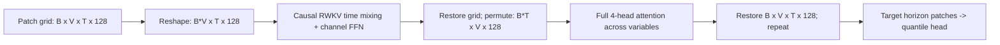

# Data, variable semantics and architecture audit — 2026-10-24

This document records the implemented contracts, changes requested in this review,
and limitations of the smoke configuration. The previous guide is preserved as
[previous_forecasting_guide.md](previous_forecasting_guide.md). Paths below are
relative to the repository root. Executable settings are in `configs/config.json`.

## 1. What the filenames mean

`table_000_evaluation_1117.parquet` means:

- `000`: zero-based index of the first **eligible source table selected for this
  run**, after lexicographically sorting `paths.raw/**/data.parquet` and skipping
  short tables. It is not a random split, category, epoch or permanent dataset ID.
- `evaluation`: a held-out future horizon from that same source table.
- `1117`: the zero-based **row offset of the first forecast label**, not a count of
  windows, filename ID, timestamp or necessarily a value in `time_index`.

The name alone does not identify the source permanently: adding files earlier in
the sort order can change the local table index. `manifest.json` now records the
source path, SHA-256 of that source, original row count, local table index,
evaluation cutoff, ordered variable names, roles, excluded columns, and explicit
context/label intervals. Intervals are half-open `[start, stop)`.

For the original example, the source is
`data/01_generated/2026-10-19/table_904393be9fa5_000000/data.parquet`.
It has 1,133 rows. With context 64 and horizon 16:

| Window | Context rows | Label rows | Purpose |
|---|---|---|---|
| `table_000_train_1072` | `[1008,1072)` | `[1072,1088)` | training |
| `table_000_train_1088` | `[1024,1088)` | `[1088,1104)` | training |
| `table_000_evaluation_1117` | `[1053,1117)` | `[1117,1133)` | evaluation |

The evaluation file is therefore 80 rows: 64 context rows and 16 labels. Its first
64 values can overlap training history/labels. Its final 16 labels never enter
training. Such historical overlap is intentional for rolling-origin forecasting.

## 2. How the split actually works

Each selected table contributes both training and evaluation windows. There is
**no random assignment of whole datasets**. For a table of length `N`, context `C`,
horizon `H`, stride `S`, the evaluation cutoff is `E=N-H`. Candidate training
cutoffs are `range(C, E-H+1, S)`. We retain the last
`train_windows_per_table` cutoffs; every training label interval ends at or before
`E`. A table needs at least `C+2H` rows.

Current defaults deliberately select only the first two eligible source tables,
two training windows per table and one evaluation window per table: four training
records and two evaluation records. Three optimizer updates cycle deterministically
through those training records, so this is not even a full epoch. The stride can
leave some recent pre-evaluation rows unused as training labels.

This is temporal evaluation on previously seen source processes. It does not
measure zero-shot generalization to unseen datasets and is not a final untouched
test set if used for model selection. Separate dataset-level validation/test
partitions are not implemented. The word `evaluation` describes the current
purpose, not an additional independent dataset pool.

## 3. Why there are processed tables and tensor files

The transform stage already reads the original dated `data.parquet` files
directly. Original numeric values are not transformed in the inspection exports;
that is why they resemble the source. It selects ordered columns, slices windows,
assigns roles, separates inputs from labels, and builds tensors. Normalization and
patching occur in the embedding stage.

Processed inspection exports now use Zstandard-compressed **Parquet**, preserving
column types and avoiding CSV parsing. They contain only the selected target and
contemporaneous covariates, plus time for inspection. Training never reads those
exports. Set `data.export_processed_tables=false` to avoid copying any tabular
windows; the original Parquet files are still the input. This switch does not
remove the tensor cache, since replayable stages are the current pipeline contract.

`data/02_processed/windows.pt` is a PyTorch serialization of a dictionary with a
configuration signature and a **list of independent window records**. Each record
contains metadata and `batch` tensors:

| Key | Shape | Meaning |
|---|---|---|
| `context` | `[1, targets, C]` | target history |
| `past_covariates` | `[1, past variables, C]` | optional observed history |
| `known_covariates` | `[1, known variables, C]` | historical part of known-future variables |
| `future_covariates` | `[1, known variables, H]` | explicitly available future values |
| `future_target` | `[1, targets, H]` | labels, never embedded as input |

The `.pt` file is not an extra model and not a rectangular combined table. It is
loaded with `weights_only=True`. Keeping both raw-window tensors and embedding
artifacts costs disk/memory; this small-corpus pipeline is not a streaming trainer.

## 4. Different lengths, column counts and column meanings

`data/03_embedded/embeddings.pt` is also a dictionary containing a list of records,
not one concatenated tensor. Each record stores its own batch, metadata, patch
features, scaling statistics and initial projected embeddings. A single `torch.save`
can hold tensors of different shapes without padding them together.

Original table lengths determine eligible window offsets. The current transform
config chooses the same `C=64`, `H=16` for all windows. The model also accepts other
lengths on separate calls; partial patches are padded. Different variable counts
remain different: after lag exclusion the first selected table has 3 variables
(outcome plus 2 covariates), and the second has 2 (outcome plus 1 covariate).
Their embedding shapes are respectively `[1,3,16,128]` and `[1,2,16,128]`: eight
history patches plus two future patches, padded to 16 for the CUDA kernel.

Training takes one record per optimizer update. It does not stack those two
tensors, align unrelated covariates, or propagate RWKV state from one source
dataset to another. Efficient mixed-schema minibatching/bucketing is future work.

Column names are preserved as audit metadata, **not semantic embeddings**.
Projection and temporal weights are shared across variables; three role embeddings
distinguish targets, past-only variables and known-future variables. No embedding
asserts that column 1 or `covariate_00` has the same physical meaning across tables.
Relationships must be inferred from the aligned values and temporal context.
Reordering covariates of the same role should preserve target forecasts up to
floating-point differences; tests check this. This design does not understand
units, textual column descriptions, categorical semantics or causal mechanisms.

Embedding snapshots are initialized before training. With `train_embeddings=true`,
the train script restores the projection weights and recomputes embeddings from
saved patch features so the projection receives gradients. With `false`, it uses
the saved initial tensors and freezes the projection. Forecasting always uses
checkpoint weights. Initial vectors are not mislabeled as trained embeddings.

## 5. Lag-derived features

Auto-selection now excludes names matching `data.excluded_column_patterns`, which
by default detects `lag`, `lagged`, `outcome_lag_1`, `temperature_lag_2`, etc.
Explicitly requesting an excluded column as a target or covariate raises an error.
Only current-time values are supplied as each variable's sequence; RWKV receives
their historical ordering and can learn delayed relationships internally.

The generator's source files are unchanged. Exclusion happens when selecting model
inputs; the excluded list is recorded for every source. Naming patterns cannot
detect arbitrary features that have been lagged but renamed without a recognizable
marker; use accurate column names/configuration. The generic low-level
`frame_window` helper slices explicitly supplied columns; the pipeline's selection
policy is enforced in `transform`.

## 6. Measured model size and dimensions

The current smoke configuration has **807,440 parameters**, not the repository's
eventual approximately 400M target. Each training run now writes a measured
`results/pipeline/training/architecture.json`, including every parameter's name,
shape, count, trainability and module totals.

| Component | Parameters | Dimensions |
|---|---:|---|
| Input residual MLP | 81,664 | `24 -> 512 -> 128`, plus `24 -> 128` skip |
| Role embedding | 384 | `3 x 128` |
| RWKV block 0 | 240,256 | width 128, FFN 512; includes initial LayerNorm |
| RWKV block 1 | 240,000 | width 128, FFN 512 |
| Variate attention 0 | 66,304 | width 128, 4 heads of dimension 32, LayerNorm |
| Variate attention 1 | 66,304 | same |
| Final LayerNorm | 256 | width 128 |
| Quantile residual head | 112,272 | `128 -> 512 -> 72`, plus `128 -> 72` skip |
| **Total** | **807,440** | **2 RWKV + 2 variate modules** |

Patch size is 8. Each patch's 24 input features are 8 values, 8 observation-mask
entries and 8 relative-time entries. Each output patch has `8 x 9 = 72` quantile
values. RWKV uses 2 heads of size 64, distinct from the 4 variate-attention heads.
There is no text tokenizer, token vocabulary or language-model output head.
The `levels` quantile buffer is not a trainable parameter. Layer-zero value-residual
gate parameters are allocated by the backend but are unused in that layer.

## 7. Two-dimensional processing: exact axes

Let `B` be independent groups, `V` variables in a group, `T` padded patch count and
`D=128` hidden width. Each repeated layer operates on `[B,V,T,D]`:



The temporal pass independently processes each variable's sequence. The variate
pass groups all variables **at one patch index within one dataset**. Its Q/K/V
attention scores have shape `[B*T,4,V,V]`, so targets can read covariate histories
encoded in the same-patch states. The next RWKV block carries those mixed states
forward in time. Group identity is the batch axis; unrelated datasets cannot
attend to each other. There is no variable-position embedding.

This is a two-axis architecture, not one enormous attention matrix over flattened
time and variable tokens. Temporal attention is replaced by recurrent RWKV
computation; only the variable axis uses softmax self-attention. Temporal work
scales linearly with patch count at fixed width; variate attention is quadratic
in `V` per patch. State starts fresh on every model call; streaming caches are
not implemented.

Chronos-2's [official encoder code](https://github.com/amazon-science/chronos-forecasting/blob/main/src/chronos/chronos2/model.py)
explicitly composes time self-attention, group self-attention and feed-forward
layers, with masks restricting cross-variable exchange to a group. We verified
that source for this audit. Our substitution is causal RWKV plus its channel FFN,
then variate attention. Chronos-2 is an encoder with different temporal attention
and normalization details, so this is an adaptation rather than an exact replica.

Future target/past-variable values are masked. Known-future covariates are visible
only where supplied. Because time processing is causal, later known covariate
patches cannot affect earlier forecasts (no lookahead concatenation). Within a
patch, all eight values are jointly embedded, so causality is at patch resolution.
Context-wide normalization uses all observed context but never future labels.

## 8. Execution, audit logs and migration

The separate commands are:

```powershell
uv run python src/03_transforming_input_data/transform.py
uv run python src/04_creating_embeddings/embed.py
uv run python src/05_model_training/train.py
uv run python src/06_forecasting/forecast.py
```

The combined `train_forecast.py` was removed; tests and documentation now import
the model from `train.py`. Forecasting imports its definitions but never calls the
training function. Windows GPU entry points dispatch to the established WSL CUDA
runtime. The Windows parent captures child output, including native backend prints.

Every invocation creates `logs/<UTC timestamp>_<stage>_<random suffix>/` containing
`events.log`, exact `config.json`, code hashes/interpreter in `provenance.json`,
and `status.json` with elapsed time and complete/failed status. Windows launcher
and WSL execution each create a run record. Logs are local artifacts excluded from
Git; documentation and the architecture snapshot supply the reviewable audit.

Old CSV inspection files were moved, not deleted, into
`logs/20261024T165350_migration/`. That archive also contains the prior processed
manifest, tensor cache, embeddings, checkpoint and legacy logs. The current stage
artifacts were rebuilt without lag columns and training/forecasting rerun. Raw
generated Parquet files were not modified. Outputs still use configured paths and
are overwritten by subsequent runs; choose distinct paths to retain experiments.

## 9. Verification

CPU pipeline tests cover temporal separation, Parquet/source equality, lag exclusion
including explicit-role rejection, optional no-copy exports, different table
lengths/variable counts in one `.pt` container, embedding round-trip and gradients,
label isolation and stale-configuration rejection. CUDA tests check covariate
permutation invariance, variable-count changes, batch isolation, missing values,
partial patches and input validation. The standalone smoke checks backward weight
updates, checkpoint reload and fresh-SCM forecasting.

See [validation.json](validation.json) for the completed run evidence, and
[architecture.json](architecture.json) for the measured parameter inventory.
These checks establish execution and structural invariants, not forecasting
accuracy, semantic understanding of unseen covariates, or large-scale throughput.
