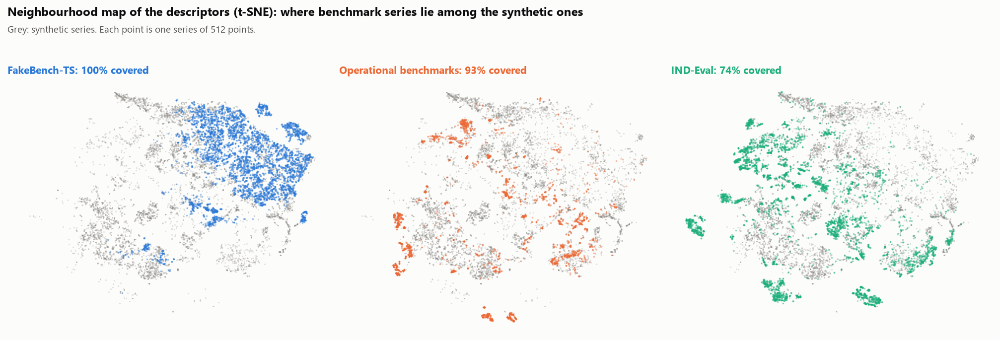
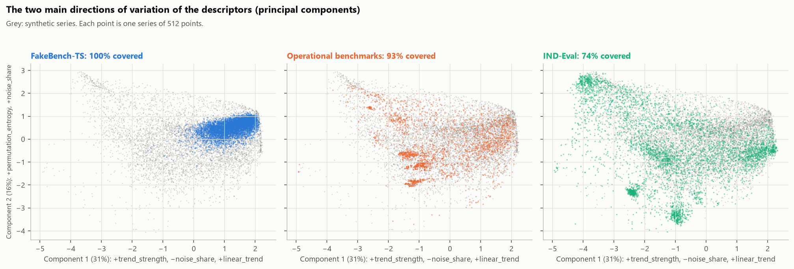
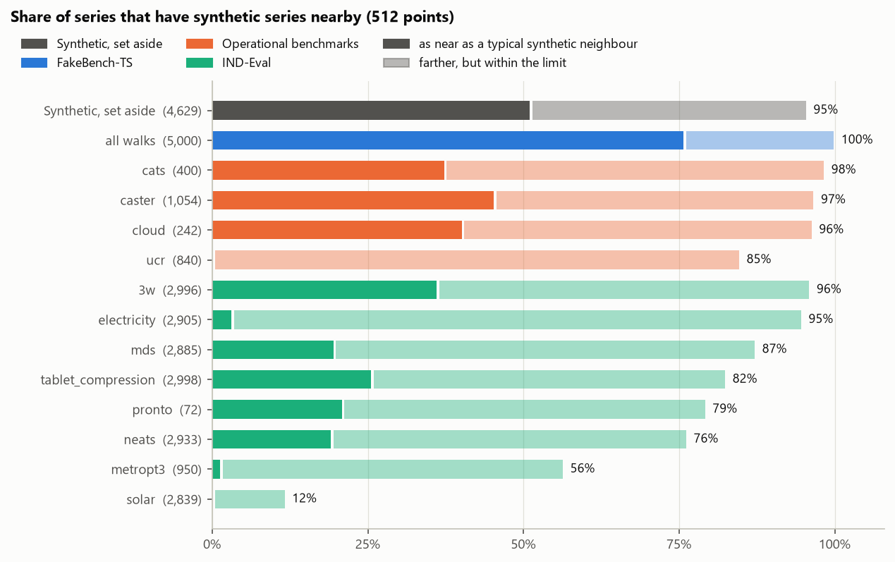
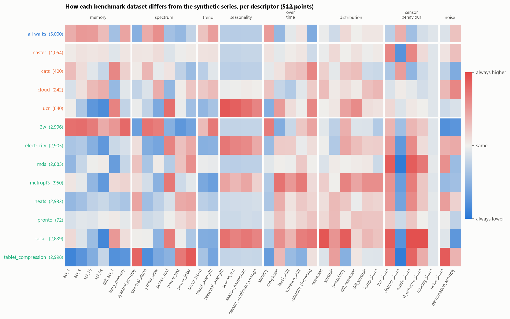
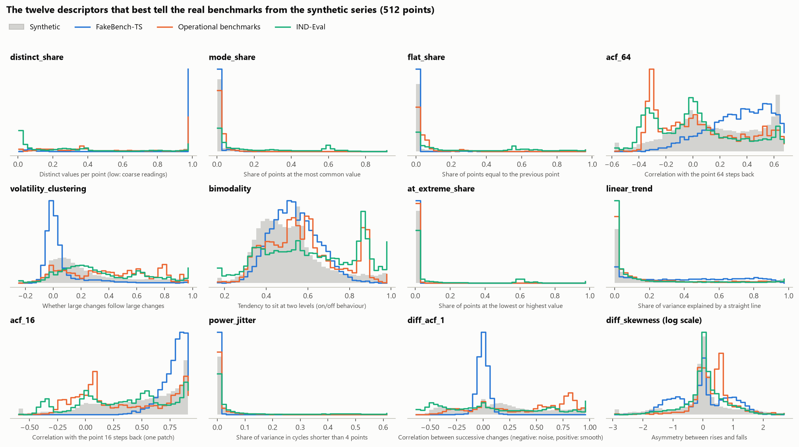
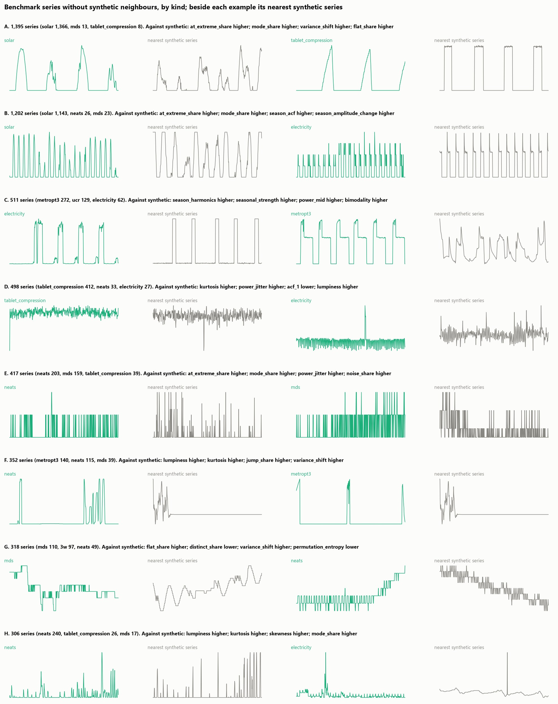
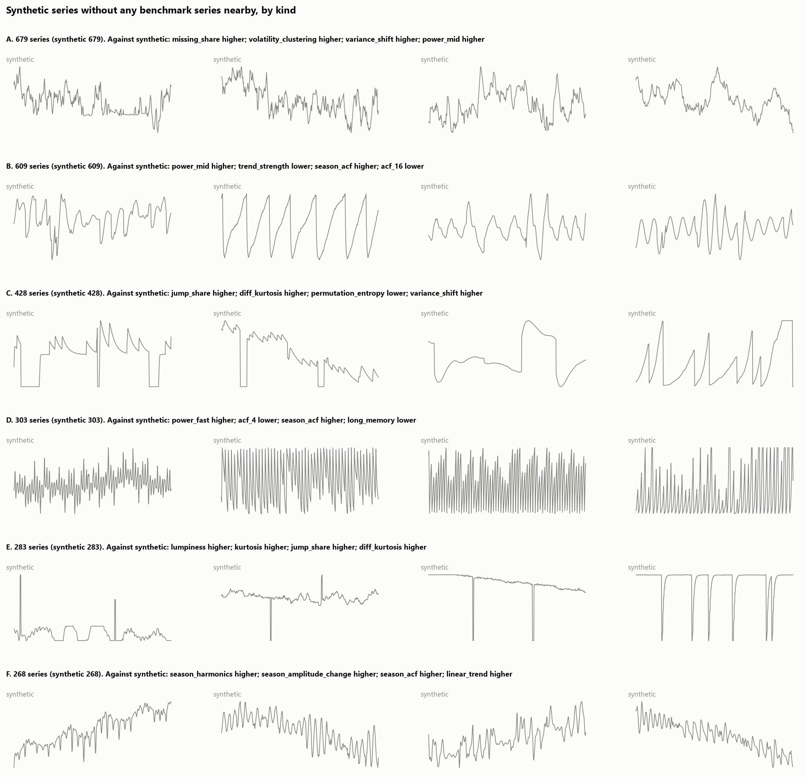
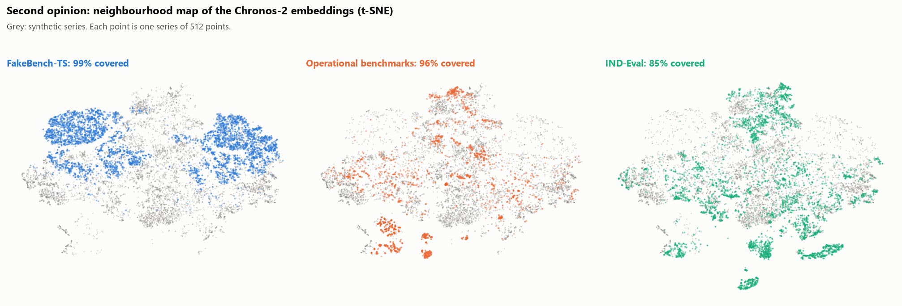

# How similar are Basin's synthetic series to the benchmark series?

28 November 2026. Epoch-3 model, validation tables of the training run.

> This report describes the generator as it was when Basin was trained. The
> generator has since been changed along the lines of "What to change in the
> generator" below; what was changed, and how each change was measured, is in
> [GENERATOR_CHANGELOG.md](GENERATOR_CHANGELOG.md).

## Summary

Basin is trained on synthetic series only. This report compares the 25,000
validation tables (the same generator as the training data) with the series
of three benchmarks: FakeBench-TS, the operational benchmarks (stage 11) and
IND-Eval (stage 12).

1. **The synthetic series are not an isolated island.** Most benchmark
   series have synthetic series nearby: 93% of the operational benchmark
   series, 74% of the IND-Eval series and all of the FakeBench-TS walks. The
   same test gives 95% for synthetic series that were set aside.
2. **But the benchmarks sit at the edge of the synthetic data, not in its
   middle.** Only 29% of the operational series and 17% of the IND-Eval
   series are as close to synthetic series as synthetic series typically are
   to each other (50% by construction for synthetic data). A classifier
   tells real benchmark series from synthetic ones almost perfectly (AUC
   0.96 to 0.99), and only about 7% of the synthetic series are of a kind
   that is typical for the real benchmarks.
3. **A quarter of IND-Eval has no synthetic counterpart.** Nearly all of it
   is of a few kinds: solar output (88% of solar series uncovered), on/off
   machine cycles (MetroPT-3, 44%), and noisy or bursty signals (NEATS,
   tablet compression).
4. **Where the series are farther from the synthetic data, Basin loses more
   against the other models.** On the stage 11 forecast cases Basin's error
   equals the average of the three other models in the nearest quarter of
   the cases and is 16% higher in the farthest quarter. Most of this comes
   from one dataset (UCR), so it is an indication, not proof.
5. **The differences point in clear directions** (ranked in
   [What to change in the generator](#what-to-change-in-the-generator)):
   more and stronger cycles at realistic lengths, cycles that rest at a
   floor, coarse and flat sensor readings as the normal case, on/off
   behaviour, and less slow drift.

So the hypothesis "the generator produces a world of its own" is not
confirmed, but a weaker form is: the generator can produce most kinds of
benchmark series, yet it produces them rarely and spends most of its tables
on kinds the benchmarks hardly contain.

An interactive 3-D map is in [map_512.html](map_512.html) (open it in a
browser; `plotly.min.js` must stay beside it). All numbers are in
[tables_512.md](tables_512.md) and [tables_2048.md](tables_2048.md).

## What was compared

One series is one target as a model sees it: the points before a forecast. A
table with covariates contributes its target column only, because that is
what a model is asked to forecast. This is how tables with and without
covariates become comparable.

| Group | Collected | Analysed at 512 points | Analysed at 2,048 points |
|---|---|---|---|
| Synthetic (Basin validation tables) | 25,000 | 22,499 | 12,719 |
| FakeBench-TS (random walks) | 5,000 | 5,000 | 2,500 |
| Operational benchmarks (forecast cases) | 5,112 | 2,536 | 2,499 |
| IND-Eval (up to 3,000 series per source) | 19,022 | 18,578 | 15,391 |

Every series is described on its latest 512 points, and again on its latest
2,048 points where it has them. Series that are too short, constant, or more
than half missing are left out. The results below are for 512 points unless
stated; the 2,048-point view agrees with them and is summarised at the end.

Two properties of the benchmark groups matter when reading the numbers:

- The operational benchmarks hold many windows of few recordings (about 190
  series from four datasets). Their windows are not independent.
- FakeBench-TS is synthetic by design (random walks). It is included because
  you asked for it, but it says nothing about real data.

## Method, and why this one

### Why descriptors and not dynamic time warping

Dynamic time warping compares two particular recordings point by point. Two
recordings of the same noisy process are far apart by that measure although
they are the same kind of series. For the question "does the generator make
this kind of series" we need a description of the kind, not of the
recording. A description of fixed size also makes the comparison cheap,
which warping at this scale is not.

### Why statistical descriptors first, embeddings second

You preferred embeddings. I used both, with different roles:

| | Statistical descriptors | Embeddings |
|---|---|---|
| Says that two groups differ | Yes | Yes |
| Says in what they differ | Yes: every number has a meaning | No |
| Depends on my choice of numbers | Yes | No |
| Cost on the CPU | Under a minute for all series | 13 minutes for 20,000 series |

The goal is to know how to change the generator, and only descriptors can
tell that. The embeddings serve as a check that the descriptors do not miss
something: they come from Chronos-2's encoder, a model that had no part in
choosing the descriptors.

I did not use Basin's own embedding. Basin has only seen synthetic series,
so where it places a series unlike those is not a reliable measure of how
unlike it is. A model trained on real data is the more neutral judge.

### The descriptors

Each series is standardised (mean 0, spread 1), so level and scale play no
part, and then described by 36 numbers in eight families:

| Family | What it describes |
|---|---|
| Memory | How strongly a point depends on earlier points, at 1, 4, 16 and 64 steps; long-memory (Hurst-type) exponent |
| Spectrum | Spectral entropy; how variance divides over slow, medium, fast and point-to-point movements |
| Trend | Share explained by a straight line; trend strength |
| Seasonality | Seasonal strength; how far the cycle is from a sine wave; how its size varies between cycles |
| Changes over time | Stability, lumpiness, level shifts, changes of spread, bursts |
| Distribution | Skewness, tail weight, two-level behaviour, jumps, asymmetry between rises and falls |
| Sensor behaviour | Flat runs, few distinct values, resting at one value or at a limit, missing points |
| Noise and complexity | Noise share (the inverse of signal-to-noise), permutation entropy |

Six of them (trend strength, seasonal strength, spectral entropy, the Hurst
exponent, stability and lumpiness) are the features that the GIFT-Eval
benchmark reports for its datasets. Describing collections of series by such
features and looking at them on a map goes back to Kang, Hyndman and
Smith-Miles (2017), who used it to show what the M3 competition data did not
cover and then generated series to fill the gaps: the same use as here. The
sensor-behaviour family is my addition, because the usual feature sets come
from business and economic data and do not describe sensors.

In a distance, every family counts equally (five ways of measuring
seasonality do not count five times), and each of the four groups counts
equally when the numbers are standardised.

### Coverage

For every benchmark series I look up its five nearest synthetic series. The
series is:

- **close** when the fifth of them is no farther away than is typical for a
  synthetic series (the median distance of a synthetic series to its own
  fifth-nearest synthetic neighbour),
- **covered** when it is no farther away than this distance is for 95% of
  the synthetic series,
- **not covered** otherwise.

A fifth of the synthetic series was set aside and treated like a benchmark.
It comes out 51% close and 95% covered, as it should. A benchmark that
resembled the synthetic data would score the same.

`annoy` was not needed. With about 50,000 series, an exact nearest-neighbour
search takes seconds, so an approximate search would only add error.

### Other measures

- **Per descriptor:** the 10%, 50% and 90% points of each group, the chance
  that a benchmark series has a higher value than a synthetic one, and the
  share of benchmark series beyond the range of 98% of the synthetic series.
- **Classifier:** a gradient-boosting classifier is asked to tell a group
  from the synthetic series, with windows of one recording kept together in
  cross-validation. An AUC of 0.5 means it cannot; 1.0 means it always can.
- **Kinds:** the uncovered series are grouped into kinds, each shown with
  examples and what sets it apart.
- **Maps:** principal components (distances are real, but only the main
  directions are shown) and t-SNE (neighbours stay together, but the size of
  an island and the space between islands mean nothing). The maps are for
  looking; every number in this report is computed in the full space.

## Results

### The map

FakeBench-TS fills one region of the synthetic cloud: random walks are
something the generator makes plenty of. The two real benchmarks are spread
over the whole cloud in small dense clumps (many windows of the same
recording), with a few islands of their own at the edges. Those islands are
the uncovered kinds described below.

The main direction of variation (31%) runs from noisy series without a
trend (left) to smooth, trending series (right). The synthetic series pile
up on the right; IND-Eval has concentrations at the upper left and at the
bottom, where the synthetic data is thin.

### Coverage per dataset

| Group | Dataset | Series | Close | Covered |
|---|---|---|---|---|
| Synthetic, set aside | | 4,629 | 51% | 95% |
| FakeBench-TS | all walks | 5,000 | 76% | 100% |
| Operational | CATS | 400 | 37% | 98% |
| Operational | Caster | 1,054 | 45% | 97% |
| Operational | Cloud monitoring | 242 | 40% | 96% |
| Operational | UCR | 840 | 0% | 85% |
| IND-Eval | 3W (oil wells) | 2,996 | 36% | 96% |
| IND-Eval | Electricity | 2,905 | 3% | 95% |
| IND-Eval | MDS | 2,885 | 19% | 87% |
| IND-Eval | Tablet compression | 2,998 | 26% | 82% |
| IND-Eval | PRONTO | 72 | 21% | 79% |
| IND-Eval | NEATS | 2,933 | 19% | 76% |
| IND-Eval | MetroPT-3 | 950 | 1% | 56% |
| IND-Eval | Solar | 2,839 | 0% | 12% |

The datasets with a daily cycle (UCR, electricity, solar) and the compressor
data (MetroPT-3) are almost never close. The process data without a cycle
(caster, CATS, 3W) looks most like the synthetic data.

The picture does not depend on the settings. With one or twenty neighbours
instead of five, IND-Eval's coverage is 72% and 75%; with the limit at 90%
or 99% of the synthetic series it is 64% and 95%, against 90% and 99% for
the synthetic series set aside.

The reverse also holds: 86% of the synthetic series have a real benchmark
series nearby. The generator is not wasting most of its output on kinds
that never occur.

### The mix is very different

| Group | Classifier AUC | AUC without sensor behaviour | Synthetic series that resemble the group |
|---|---|---|---|
| Synthetic, set aside | 0.50 | 0.50 | 48% |
| Operational benchmarks | 0.96 | 0.91 | 2% |
| IND-Eval | 0.99 | 0.97 | 7% |
| Operational and IND-Eval together | 0.98 | | 7% |
| FakeBench-TS | 1.00 | 1.00 | 2% |

"Resemble" means that the classifier finds the series at least as likely to
be a benchmark series as a synthetic one. Coverage and this table answer
different questions. Coverage asks whether the generator can make a kind of
series at all; mostly it can. The classifier asks whether it makes them in
the same proportions; it does not. If the synthetic tables were reweighted
to the mix of the real benchmarks, they would be worth about 3% of their
number.

For training this is the more important result. A model learns what it sees
often. Kinds that are common in the benchmarks are rare in the training
data.

### What differs

Red means the dataset has higher values than the synthetic series, blue
lower. Three patterns stand out: the red block under seasonality for UCR,
electricity, MetroPT-3 and solar; the red and blue columns under sensor
behaviour for nearly every real dataset; and the blue under trend for most
of IND-Eval.

The largest differences, with the 10% / median / 90% points of each group:

| Descriptor | Synthetic | Operational | IND-Eval | Meaning |
|---|---|---|---|---|
| Distinct values per point | 0.24 / 1.00 / 1.00 | 0.13 / 0.67 / 1.00 | 0.01 / 0.25 / 0.94 | Real readings are coarse; synthetic ones are mostly continuous |
| Share of points equal to the previous one | 0.00 / 0.00 / 0.36 | 0.00 / 0.02 / 0.25 | 0.00 / 0.24 / 0.81 | Real sensors stand still a lot |
| Share of points at the most common value | 0.00 / 0.00 / 0.15 | 0.00 / 0.01 / 0.05 | 0.01 / 0.13 / 0.62 | Real series rest at one value (off, zero, a set point) |
| Share of points at the lowest or highest value | 0.00 / 0.00 / 0.06 | 0.00 / 0.00 / 0.01 | 0.00 / 0.01 / 0.61 | Real series rest at a limit |
| Share explained by a straight line | 0.00 / 0.14 / 0.91 | 0.00 / 0.06 / 0.75 | 0.00 / 0.03 / 0.68 | Synthetic series drift more |
| Variance in movements slower than 128 points | 0.03 / 0.52 / 0.84 | 0.02 / 0.30 / 0.86 | 0.01 / 0.26 / 0.85 | Synthetic series wander slowly; real ones return to a level |
| Correlation 64 steps back | -0.23 / 0.15 / 0.61 | -0.32 / 0.00 / 0.55 | -0.36 / -0.01 / 0.53 | The same, seen differently |
| Large changes follow large changes | -0.01 / 0.16 / 0.75 | -0.01 / 0.38 / 0.80 | 0.02 / 0.29 / 0.82 | Real series have calm and busy stretches |
| Two-level behaviour | 0.35 / 0.50 / 0.77 | 0.36 / 0.56 / 0.86 | 0.33 / 0.60 / 0.90 | Real series switch between two states more |
| Noise share | 0.00 / 0.08 / 0.46 | 0.01 / 0.06 / 0.42 | 0.00 / 0.14 / 0.86 | Part of IND-Eval is far noisier than anything synthetic |

Cycles deserve their own table, because half of all series have none and
the medians above hide them:

| Group | Has a cycle | Strong cycle | Cycle length: 25% / median / 75% |
|---|---|---|---|
| Synthetic | 31% | 12% | 15 / 36 / 86 points |
| Operational benchmarks | 41% | 34% | 24 / 24 / 98 |
| IND-Eval | 36% | 29% | 24 / 96 / 139 |
| UCR | 100% | 99% | 24 |
| Electricity | 84% | 79% | 96 |
| Solar | 89% | 87% | 141 |
| MetroPT-3 | 64% | 50% | 125 |

Strong cycles are two to three times as common in the real benchmarks as in
the synthetic data, and in the datasets where Basin does worst nearly every
series has one. The real cycle lengths are the day at common sampling rates
(24 points for hourly data, 96 for 15 minutes, 144 for 10 minutes). The
synthetic cycle lengths are spread out and mostly shorter. On 2,048 points
the difference grows: 8% of the synthetic series have a strong cycle,
against 38% of IND-Eval.

### Kinds of benchmark series the generator does not produce

About 5,000 real benchmark series are not covered. They fall into eight
kinds. Beside each example is the nearest synthetic series, which shows how
close the generator gets.

| Kind | Series | Mostly from | What it is |
|---|---|---|---|
| A, B | 2,597 | Solar | A daily hump that rests at zero for half the cycle, with a different height every day |
| C | 511 | MetroPT-3, UCR, electricity | On/off cycles with a shaped plateau: a machine that loads and unloads |
| D | 498 | Tablet compression | Noise around a level, no memory, occasional extreme points |
| E | 417 | NEATS, MDS | Signals that flip quickly between two values |
| F | 352 | MetroPT-3, NEATS | Rare bursts on an otherwise flat line |
| G | 318 | MDS, 3W | Coarse step-like readings with long flat stretches |
| H | 306 | NEATS | Positive spikes of varying height on a floor |

In several rows the nearest synthetic series is of the right family (humps
on a floor for solar, square waves for the on/off cycles). The generator has
the mechanism, but not the right shape, and too few examples of it.

### Synthetic kinds without a benchmark counterpart

14% of the synthetic series have no real benchmark series nearby.

The largest kind (679 series) simply has missing values, which the
benchmark windows do not have. The others are wandering series without a
trend, decaying sawtooth shapes with drop-outs, fast oscillations, and
trending series with a strong cycle. None of this is an error: the
benchmarks cover a small part of all real data. It only means that these
tables do not help on these benchmarks.

### Does distance go with Basin's errors?

For the 2,535 forecast cases of stage 11 with a history of 512 points I
compared Basin's error at 112 steps with the average error of Chronos-2,
Timestral and TimeH2O. Above 1.00, Basin is worse.

| Quarter of the cases, by distance to the synthetic series | Basin's error over the others | Cases where Basin is worse |
|---|---|---|
| Nearest | 1.00 | 50% |
| Second | 1.01 | 56% |
| Third | 1.13 | 70% |
| Farthest | 1.16 | 73% |

| Dataset | Basin's error over the others | Median distance (1.00 = typical for synthetic) |
|---|---|---|
| Caster | 1.00 | 1.04 |
| CATS | 1.00 | 1.07 |
| Cloud monitoring | 1.01 | 1.09 |
| UCR | 1.22 | 1.39 |

Basin matches the other models where the series resemble its training data
and falls behind where they do not. The descriptors that go most with Basin
losing are the shape of the cycle (how far it is from a sine wave) and
two-level behaviour.

This supports the hypothesis, with two reservations. The trend is mostly
the difference between UCR and the other three datasets; within datasets
the relation is weak (rank correlation 0.13). And UCR is 35 series from
three sources. IND-Eval will be the better test once stage 12 has finished:
if the hypothesis holds, Basin should be weakest on solar, MetroPT-3 and
electricity and closest to the other models on 3W.

### Second opinion: Chronos-2 embeddings

| Group | Close (descriptors) | Close (embeddings) | Covered (descriptors) | Covered (embeddings) | Classifier AUC (embeddings) |
|---|---|---|---|---|---|
| Synthetic, set aside | 51% | 49% | 95% | 95% | 0.51 |
| FakeBench-TS | 76% | 57% | 100% | 99% | 0.97 |
| Operational benchmarks | 29% | 38% | 93% | 96% | 0.92 |
| IND-Eval | 17% | 23% | 74% | 85% | 0.94 |

The embeddings give the same picture, slightly milder: the benchmarks are
mostly within reach of the synthetic data but rarely in its middle, and a
classifier separates them easily. The two methods agree on which series are
covered for 75% of IND-Eval and 90% of the operational series. They
disagree most on solar (12% covered by descriptors, 64% by embeddings) and
MetroPT-3 (56% and 99%): Chronos-2 seems to care less about the long flat
stretches that the sensor-behaviour descriptors weigh heavily. Both agree
that electricity and solar are almost never close (0% to 3%).

The embeddings cover a random part of each group (20,353 series), not all
of them.

### At 2,048 points

| Group | Close | Covered | Classifier AUC |
|---|---|---|---|
| Synthetic, set aside | 49% | 95% | 0.49 |
| FakeBench-TS | 80% | 100% | 1.00 |
| Operational benchmarks | 26% | 97% | 0.97 |
| IND-Eval | 7% | 69% | 0.99 |

The same conclusions, a little sharper for IND-Eval (solar: 1% covered).
Only half of the synthetic tables are long enough for this view: 49% have
fewer than 2,048 rows, while 81% of the IND-Eval histories fill the full
2,048 points. Long histories with several daily cycles are therefore rarer
in training than in this benchmark.

## What to change in the generator

Ranked by how much of the difference each would remove, combined with how
clearly it relates to Basin's errors. The targets are what the real
benchmarks show; they are directions, not exact values to hit.

| # | Direction | Synthetic series now | Real benchmarks | Generator setting it relates to (share of tables now) |
|---|---|---|---|---|
| 1 | More series with a strong cycle | 12% | 30% to 40%; nearly all of electricity, solar and UCR | A season on the target: 39%, yet a strong cycle is measured in only 12% |
| 2 | Cycle lengths of real sampling rates: 24, 48, 96, 144, 168, 288 points | Spread out, median 36 | Concentrated at 24, 96 and about 144 | The lengths the seasons are drawn from |
| 3 | Cycles with real shapes: resting at a floor for part of the cycle, flat plateaus, a height that changes from cycle to cycle | Mostly smooth waves | Solar, load curves, compressor cycles | Calendar gate on a season: 10% |
| 4 | Coarse and flat readings as the normal case | Median: every point a distinct value, no flat points | IND-Eval median: one distinct value per four points, a quarter of the points flat; operational in between | Quantised target: 25%; sensor limits: 4%; stuck, hold, deadband and clip: 2% to 3% each |
| 5 | Less slow drift, more return to a level | 52% of the variance in slow movements | 26% to 30% | A trend on the target: 50%; an integrator on the way to it: 20% |
| 6 | On/off and two-level behaviour, with a fast rise and a slow fall | Rare | MetroPT-3, NEATS, MDS, UCR | Operating modes (shutdown, episode, reset): 14% |
| 7 | Calm and busy stretches; channels that are mostly noise | Bursts 0.16, noise share 0.08 | Bursts 0.3 to 0.4; part of IND-Eval far noisier | Changing volatility: 20%; the noisy profile: 8% |
| 8 | Longer tables | 51% reach 2,048 rows | 81% of the IND-Eval histories | Table length |

The last column comes from 3,000 tables sampled with the generator's current
settings. It names the setting I expect to matter; that a setting moves a
descriptor has to be checked with the procedure below, not assumed.

The evidence per row: the cycle table (1, 2), kinds A to C and the link with
Basin's errors (3), the largest descriptor differences (4), the trend family
(5), kinds C, E and F (6), kinds D and H (7), the lengths (8).

Points 1 to 3 belong together and I would do them first. They are the kinds
where Basin does worst, and they agree with what the per-case analysis of
stage 11 showed earlier (Basin behind on every one of the 35 UCR series,
most on electricity and spacecraft telemetry).

Point 5 deserves attention because it explains an earlier finding from the
other side. Half the variance of a typical synthetic series is slow
wandering, twice as much as in the real benchmarks. A model trained on that
learns that the recent direction continues. On FakeBench-TS, where it does
not, Basin read too much into recent trends.

### A warning about tuning to benchmarks

If the generator is tuned until it matches IND-Eval and stage 11, and Basin
is then scored on IND-Eval and stage 11, the scores no longer measure how
Basin does on unseen kinds of data. Two ways to keep the test honest:

- Take the targets from one part (say IND-Eval and the public datasets in
  `data/00_public`) and keep another part out of all tuning (stage 11, or a
  public leaderboard such as GIFT-Eval).
- Aim at properties that are general for sensor data (daily cycles, coarse
  readings, resting at a limit) and not at the particular datasets.

### How to check a change before training

1. Change the generator and generate a few thousand tables into a folder.
2. Point this stage at the folder (`dataset_similarity.synthetic.source`,
   see the stage's README) and run it. It takes about 20 minutes on the CPU
   without the embeddings.
3. Compare, per benchmark dataset, the share close and covered, the
   classifier AUC and the descriptor table with the numbers in this report.

Use the same number of tables for both generators: a larger synthetic set
lies closer together, which tightens the limit.

For every synthetic validation table the analysis also saves how much it
resembles the real benchmarks (`benchmark_likeness` in
`results/model/dataset_similarity/analysis_512.parquet`). A next step, not
done here, is to generate tables with their generator settings recorded and
relate the settings to this number. That would say which existing
mechanisms already produce benchmark-like series and should be drawn more
often.

## Limits

- The benchmarks are three collections, not "real data". Coverage of them
  says nothing about other domains.
- The descriptors describe one series at a time. They say nothing about how
  a target relates to its covariates.
- Being near in descriptor space does not guarantee that forecasting skill
  transfers. The accuracy table tests this on stage 11 only.
- Windows of one recording are counted separately. Numbers per dataset are
  more trustworthy than the totals per group, and the IND-Eval sample takes
  the same number of series from each source whatever its size.
- "Covered" is a lenient test (the limit is what 95% of synthetic series
  satisfy among themselves). "Close" is the strict one. The truth about how
  well a kind is represented lies in the mix, not in either threshold.
- The synthetic side is the validation tables. They come from the same
  generator as the training tables, so they stand for the training data.
- The interactive map was loaded in a headless browser and drew its points
  and legend; clicking through it was not tested by me.

## Sources

- GIFT-Eval: [paper](https://arxiv.org/abs/2410.10393),
  [Salesforce blog](https://www.salesforce.com/blog/gift-eval-time-series-benchmark/)
  (the six dataset features).
- Kang, Hyndman and Smith-Miles (2017),
  [Visualising forecasting algorithm performance using time series instance spaces](https://ideas.repec.org/a/eee/intfor/v33y2017i2p345-358.html).
- Kang, Hyndman and Li, [GRATIS: generating time series with diverse and controllable characteristics](https://arxiv.org/abs/1903.02787).
- [Chronos-2](https://arxiv.org/abs/2510.15821); its use for embedding
  analysis in [Non-stationarity in the embedding space of time series foundation models](https://arxiv.org/abs/2604.16428).
- From memory, not looked up again for this report: `catch22` (Lubba et al.,
  2019) for the feature families; Kynkäänniemi et al. (2019) for coverage by
  nearest neighbours; Lopez-Paz and Oquab (2017) for the classifier test.
