# Basin 307M and direct multi-patch forecasts

**Superseded defaults (2026-11-02):** this document records the original
16-lead, 256-step implementation and its benchmark. New default training uses
four leads, 64 direct timesteps and 80/16/3/1 weighted losses; validation reserves
four patches. See [the current specification](SHORT_HORIZON_TRAINING.md).
The current default has since grown to 22 layers / 394,914,080 parameters.
The measured timings below remain historical results, not new four-lead or
22-layer timings.

Implementation audit, 2026-10-31. Measured timings and numerical checks are in
[`../time_benchmark/fast_inference/REPORT.md`](../time_benchmark/fast_inference/REPORT.md).

## Architecture and migration

`configs/config.json` selects 17 RWKV-7 layers, width 1024, FFN width 4096,
16 temporal heads of size 64, and 16 cross-variable attention heads. Context is
2048 observations, patch size 16, with nine quantiles. The input projection remains
jointly trained and produces 1024-dimensional tokens. No lagged covariates are added.

The backbone and original next-patch head contain 307,292,448 parameters. Fifteen
learned 1024-dimensional lead vectors add 15,360 parameters: **307,307,808 total**.
For lead zero the head is unchanged. For leads 1 through 15, the selected hidden
state plus a learned lead vector passes through the same normalization and residual
projection. This returns 256 timesteps in one backbone pass. Requested horizons
below 256 select the necessary leads and trim the last patch. Longer requests
roll forward in blocks of 256, feeding back medians and marking future historical
covariates missing. Each block caps input at the final 2048 observations.

This is a new forecasting head and training objective. Its speed is measurable
before training, but useful long-horizon accuracy requires training. Truncating an
existing 25-layer checkpoint is only a latency experiment, not a trained 307M model.

```mermaid
flowchart LR
  A[Outcome and matched covariates] --> B[Final 2048 points]
  B --> C[16-point patches and causal normalization]
  C --> D[Learned 1024-wide embeddings]
  D --> E[17 RWKV time-mixing and variable-mixing layers]
  E --> F[Final real hidden state]
  F --> G[Add lead vectors 0 through 15]
  G --> H[Shared forecast projection]
  H --> I[Up to 256 values with nine quantiles]
```

The new default artifacts live under `model` in processed,
embedded and result directories. The former paths and settings are preserved in
`configs/legacy_447m.json`; old weights and results are untouched. Run the transform,
patch indexing and training stages with the new default configuration.
The strict artifact signature includes model settings, so old preprocessing
artifacts must not simply be renamed. New checkpoints resume automatically within
the new training directory. The old 447M checkpoint cannot resume a 307M training run.

## Training and leakage boundaries

Every input token still predicts its immediate next patch. In addition, training
samples one later lead from 1 through 15 for each input position and predicts that
patch from the same causal hidden state. The default loss is an equal mixture of
next-patch and longer-lead pinball losses, controlled by `multi_horizon_weight`.
Sampling avoids projecting every training token into 16 forecast patches at once.
Out-of-range, missing and padded labels are masked. When no later labels exist,
only the next-patch loss is used.

The auxiliary targets come exclusively from the existing training-label tensor.
They do not include the final validation patch or any holdout table. Labels never
enter the embedding or temporal backbone. Covariates remain observed historical
values only. Validation continues to measure the final next patch of every admitted
training table; holdout source selection and the five forecast origins are unchanged.
Training loss now mixes two lead objectives, so compare validation metrics against
validation metrics when assessing improvement.

## Execution paths

`fast_inference.py` provides bounded CUDA graph replay. It captures the network's
GPU operations for a shape and replays them, reducing Python and kernel-launch
overhead. CPU preprocessing, transfers and output validation remain part of the
request. First-use capture costs time and is recorded separately in the benchmark.
Graph outputs are copied before returning; later requests cannot mutate them.
An engine belongs to one model and must not be shared by concurrent threads.

The holdout and forecasting stages enable this through
`training.inference_cuda_graphs: true` and `inference_graph_cache_size: 8`.
The cache retains at most eight shapes; other shapes use the original eager
network rather than repeatedly evicting and recapturing graphs. Disable the flag
to use eager inference throughout. Training has its own
[bounded forward/backward graph path](../time_benchmark/training_graph_schedule/REPORT.md)
for eligible uncheckpointed variable-mixing layers, available as an option and
disabled by default after mixed-data timing tests; validation uses its existing
path. Graphs are runtime objects,
not checkpoint weights, and must be warmed again after restarting the process.

The inference recurrence in `recurrent_kernel.cpp` / `.cu` follows the vendored
RWKV-7 equations and accumulation order, uses FP32 matrix state and BF16
activations, and launches on PyTorch's current CUDA stream. The vendored training
kernel launches on the default stream; capturing it without this adjustment would
be unsafe. The training kernel and backward implementation are unchanged.

The separate experimental recurrent mode stores each layer's temporal matrix,
previous time-mix input and previous channel-mix input. It can process just the
new patch until the window slides. A window slide changes prefix statistics and
time coordinates, so the implementation resets state and rereads the final 2048
points. It never silently retains older observations. Variable attention still runs
at every new patch. Requests always start with independent state.

Recurrent decoding remains sequential across predicted patches; it is not a
single-pass 256-step output. Direct multi-lead decoding is the route that removes
those sequential model calls. BF16 kernels can round differently for one-token
versus full-context matrix multiplications; the benchmark reports this drift rather
than treating the two executions as bitwise identical.

## Sources

- [RWKV authors' hybrid prefill/recurrent inference implementation](https://github.com/BlinkDL/RWKV-LM/blob/main/RWKV-v7/rwkv_v7_demo_fast.py)
- [PyTorch CUDA graph semantics and static-buffer requirements](https://docs.pytorch.org/docs/main/notes/cuda.html#cuda-graphs)
- Vendored `third_party/rwkv-lm/RWKV-v7/train_temp/src/model.py` and
  `cuda/rwkv7_clampw_v3_for_h100.cu` are the executable mathematical reference.

RWKV's fixed-size recurrent state is useful for incremental decoding, but linear
sequence complexity alone does not guarantee faster wall-clock forecasts. Kernel
launches, precision, model size, forecast head and the number of sequential model
calls matter substantially on this GPU.
