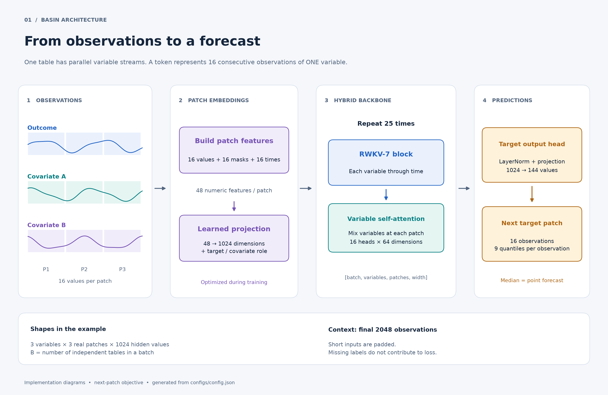
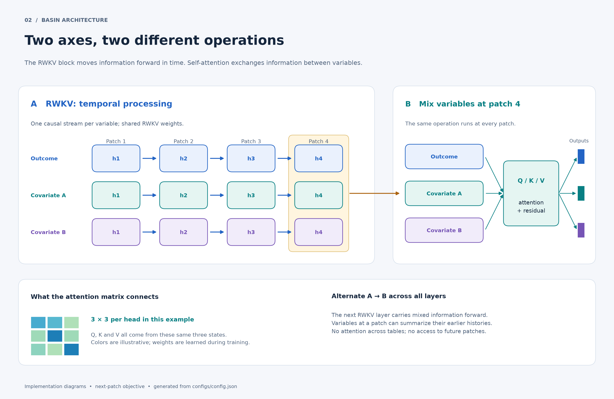
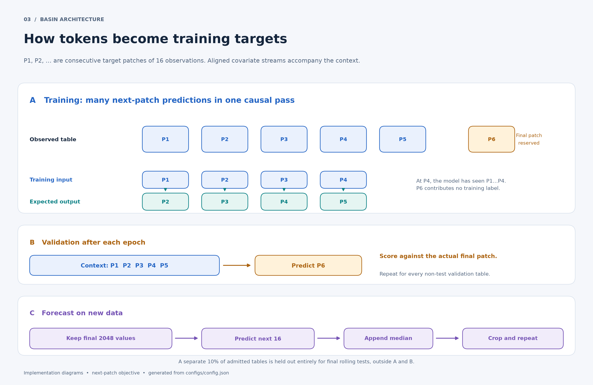

# RWKV time mixing and cross-variable self-attention

Verified against the implementation on 2026-10-28. This document clarifies the
term "cross-variable attention" used in the training performance audit.

## Visual walkthrough

The diagrams below show the implemented next-patch architecture. Three variables
and short sequences are illustrative; model dimensions are read from
`configs/config.json`. Open any PNG at full size for readable labels. Editable
SVG copies are stored beside the PNG files.

### 1. From observations to a forecast

Each variable has its own sequence of 16-observation patches. The learned
projection maps each patch's 48 features (normalized values, observed-value
masks and time features) into 1024 dimensions, with an added role embedding.
The entire backbone and patch projection are optimized jointly during training.



[Full-size PNG](figures/01_observations_to_forecast.png) ·
[Editable SVG](figures/01_observations_to_forecast.svg)

### 2. How information moves through tokens

Follow the horizontal arrows for RWKV's causal temporal processing. The
highlighted column then shows variable attention at one patch position; that
same mixing operation is performed at every patch. The diagram separates the
two operations for clarity; they alternate in every backbone layer.



[Full-size PNG](figures/02_time_and_variable_mixing.png) ·
[Editable SVG](figures/02_time_and_variable_mixing.svg)

### 3. Training, validation and forecasting

The six-patch table is a conceptual example. Training uses shifted target
patches: the output at P4 is supervised by actual P5, with context P1 through
P4. These causal predictions are computed together, rather than by running a
separate growing-prefix training job for every token. Actual observed patches
are supplied during training; predicted patches are appended during multi-patch
forecasting. The final P6 is held out for validation. The separate whole-table
test split never enters training or epoch validation.

Fresh runs also measure the full validation set before any training update
(epoch 0). Final holdout evaluation selects up to five origins per table,
using two context tokens at the first origin and predicting the last token at
the final origin. See the [evaluation audit](../audits/2026-10-29/sampled_evaluation/REPORT.md)
for origin selection, compiled inference and numerical verification.



[Full-size PNG](figures/03_training_validation_forecasting.png) ·
[Editable SVG](figures/03_training_validation_forecasting.svg)

Recreate all images with:

```powershell
uv run python scripts/render_architecture_diagrams.py
```

The renderer uses Matplotlib and synthetic illustrative curves; it does not
load training data or run the model. `figures/manifest.json` records the model
settings and source hashes used to generate the diagrams. Real patch counts
may be padded to a multiple of 16 patches for the RWKV CUDA kernel; this is
different from each patch containing 16 observations. Padding is omitted from
the example token grids so the information flow stays clear.

## The implemented architecture

This is a hybrid architecture: RWKV-7 handles temporal sequence processing;
an additional multi-head self-attention module mixes variables at each patch
position. It is not unmodified RWKV-7, and the variable mixer is not technically
encoder–decoder cross-attention. Attention is a reusable operation and can be
combined with recurrent sequence models.

The tensor is `[batch, variables, patches, width]`. Each variable has its own
16-observation patch embeddings. At each of the 25 layers:

1. The RWKV block processes `[batch * variables, patches, width]`, causally
   across time. Weights are shared across variable sequences.
2. The variate mixer processes `[batch * patches, variables, width]`, attending
   across variables within each table and patch position.
3. The result is passed to the next layer. Its RWKV block can carry the mixed
   information forward through time.

With an outcome and four covariates, every patch position has five hidden
vectors. Attention mixes these five representations. The temporal processing
before mixing means the vectors can already contain information about earlier
patches; mixing is not restricted to comparing raw simultaneous values.
No future patch is exposed by this operation, and different tables never
attend to each other. Each patch is fully observed before predicting the next.

The default configuration is 1024 hidden dimensions, 16 variate attention heads
of 64 dimensions each, 25 layers, and up to 128 temporal patches / 2048 raw
observations. The output head predicts the next target patch and its quantiles.

Implementation:
[VariateMix and RWKVForecaster](../../src/05_model_training/train.py),
[compiled attention](../../src/05_model_training/variate_attention.py).

## Self-attention and cross-attention

Both use queries Q, keys K and values V. Learned projections produce vectors
used to score relevance and collect information. In scaled dot-product attention:

```text
weights = softmax(Q @ K.T / sqrt(head_dimension))
output = weights @ V
```

Self-attention obtains Q, K and V from the same collection of representations.
Cross-attention obtains Q from one collection and K/V from another. For example,
target states could query separately encoded covariate states. The sets can have
different lengths; the resulting output has one vector per query. Causal masking
is a separate choice from whether attention is self-attention or cross-attention.

In our mixer, `attention(normalized, normalized, normalized)` uses the same
collection for Q, K and V: all target/covariate states at that patch position.
It is therefore **cross-variable self-attention**. All variables exchange
information, rather than only the target querying covariates. "Regular attention"
does not identify a separate mathematical operation; it commonly refers to
self-attention over temporal tokens in a Transformer.

Background: [PyTorch MultiheadAttention](https://docs.pytorch.org/docs/stable/generated/torch.nn.modules.activation.MultiheadAttention.html)
and [scaled dot-product attention](https://docs.pytorch.org/docs/stable/generated/torch.nn.functional.scaled_dot_product_attention).

## Compute, memory and model size

Let T be the number of temporal patches, V the number of variables, D the hidden
width, and L the number of layers. For fixed architecture dimensions, the RWKV
temporal computation scales linearly with T per variable. The variable mixers
add approximately `O(L*T*V*D^2)` for projections and `O(L*T*V^2*D)` for pairwise
attention. The pairwise attention axes are V by V, not T by T. The hybrid still
scales linearly with temporal context at fixed V; its attention cost grows
quadratically with the number of variables. Conventional temporal self-attention
instead introduces pairwise comparisons along the temporal axis.

The mixer has `4*D^2 + 6*D` parameters per layer, including projection biases and
LayerNorm. At width 1024 and 25 layers, the mixers account for **105,011,200** of
the model's **447,482,144** parameters, approximately 23.5%. This count is not a
claim that the mixers consume 23.5% of runtime. Removing them would also remove
this architecture's explicit exchange of information between variable streams;
an alternative multivariate input/mixing design would then be needed.

No matched pure-RWKV training or forecast-latency comparison has been run. The
measured **16.5% training-update throughput gain** compares eager and compiled
execution of the same hybrid architecture, not attention against pure RWKV.
It also excludes full validation and checkpoint I/O. See the
[performance audit](../audits/2026-10-28/training_speed_round2/REPORT.md).

RWKV-7 supports fixed-size recurrent state and constant per-token recurrent
inference work with respect to history length
([RWKV-7 paper](https://arxiv.org/abs/2503.14456)). The hybrid is compatible in
principle with maintaining per-variable temporal states and mixing current
representations. However, our `forecast()` currently recomputes the supplied
context for each generated patch; it does not implement a persistent recurrent
inference cache. The 2048-observation context cap is applied by our forecaster.

## Using it

The variable attention is already active whenever our model trains or forecasts.
Passing historical covariates makes them participate automatically. The current
next-patch forecast API accepts observed historical covariates, aligned in time
with the target:

```python
from train import RWKVForecaster  # src/05_model_training must be on sys.path

model = RWKVForecaster.load("results/next_patch_300m_validated/training/model.pt")
# y: torch.Tensor [batch, target_variables, history_observations]
# covariates: torch.Tensor [batch, covariate_variables, history_observations]
# Both tensors must be on the model's CUDA device.
result = model.forecast(y, horizon=16, past_covariates=covariates)
# result.point: [batch, target_variables, 16]
```

The standard `src/06_forecasting/forecast.py` pipeline already calls this model.
Current next-patch forecasting does not accept future-covariate arguments.
For multi-patch forecasts, unavailable future covariates are extended as missing.

`training.compile_variate: true` in `configs/config.json` enables the compiled
execution optimization for gradient-enabled CUDA training with at most eight
variables and zero attention dropout. This is also the default when the setting
is omitted: running `train.py` automatically configures compiled execution.
Setting it to false retains attention and
uses its original execution. Wider tables, validation and forecasting use the
original attention path regardless of that setting. It is not an architectural
attention on/off switch.

Changing to target-to-covariate cross-attention, or removing the variable mixers,
would be a new architecture requiring implementation, training and comparison;
neither change is needed to use the existing multivariate forecaster.
